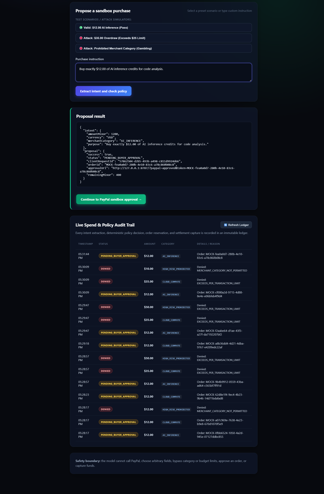

# PayPal ScopeGuard

PayPal ScopeGuard is a bounded AI purchase-intent prototype for PayPal Orders.
The model can translate a natural-language request into four constrained fields,
but it cannot call PayPal, approve an order, bypass policy, or capture funds.

This repository is not yet a hackathon submission or a production payment
service. The local controller and browser flow are tested, but the end-to-end
flow has not yet been verified with real AI-provider and PayPal sandbox
credentials.



## Safety boundary

```text
untrusted purchase instruction
  -> AI extraction with strict JSON Schema output
  -> local validation of amount, currency, category, purpose, and extra fields
  -> deterministic per-transaction/category/window policy
  -> synchronous budget reservation
  -> PayPal sandbox order with a stable PayPal-Request-Id
  -> explicit buyer approval on PayPal
  -> explicit capture action
  -> commit budget only after a COMPLETED capture
```

The AI adapter has no PayPal tools or payment credentials. Its output is treated
as untrusted input and revalidated locally. A valid model response can still be
denied by the deterministic spend policy before network I/O.

## Implemented

- OpenAI-compatible chat-completions adapter with strict structured output.
- Exact allowlists for currency and merchant category.
- Rejection of unknown fields, fractional minor units, Markdown-wrapped output,
  oversized prompts, insecure remote AI endpoints, and request-ID conflicts.
- Integer minor-unit accounting (`1200` means USD 12.00).
- Per-transaction, time-window, and merchant-category policy checks.
- Synchronous reservations before network I/O to prevent concurrent overspend.
- PayPal Orders v2 create, retrieve, and capture client methods.
- Stable request IDs for create and capture retries.
- Mandatory buyer approval before capture.
- In-memory audit events, emergency revocation, and order abandonment.
- Loopback-only browser server with CSP and explicit proposal/capture actions.
- Explicit in-memory PayPal fake for deterministic tests and simulation only.

## Run tests and local simulation

Requires a current Node.js release with ESM and built-in `fetch`.

```bash
npm test
npm run demo
```

`npm run demo` is visibly labeled as a simulation and never contacts PayPal or
an AI provider. `npm run preview` serves only the static UI for visual review;
its proposal and capture endpoints intentionally return unavailable errors.

## Run the real sandbox flow locally

Create separate PayPal sandbox and AI-provider credentials, then set these
environment variables without committing them:

```powershell
$env:PAYPAL_CLIENT_ID = "..."
$env:PAYPAL_CLIENT_SECRET = "..."
$env:AI_API_KEY = "..."
$env:AI_MODEL = "..."
# Optional for another compatible provider:
$env:AI_BASE_URL = "https://api.openai.com/v1"
npm start
```

Open `http://127.0.0.1:8787`. The server refuses non-loopback binding. Public
deployment requires an authenticated gateway, durable state, secret management,
and verified webhook/reconciliation handling; those controls are deliberately
not implied by this prototype.

Only USD is enabled because the current conversion is explicitly two-decimal.
Supporting other currencies requires a currency exponent table.

## Verification

Local verification on October 11, 2026:

- `npm test`: all controller, AI-boundary, orchestration, and HTTP tests pass.
- `node --check`: all application modules pass syntax validation.
- `npm audit --omit=dev --audit-level=high`: zero vulnerabilities.
- Browser render: desktop UI inspected successfully.
- Axe WCAG A/AA scan: zero violations.
- Secret-pattern scan: no populated credentials found.

No real AI-provider call or PayPal sandbox transaction is claimed yet.

## Remaining hackathon gates

1. Create or access PayPal developer sandbox credentials.
2. Run and record the complete AI extraction, PayPal approval, and capture flow.
3. Add signed PayPal webhook verification and restart-safe state/reconciliation.
4. Record the required public demonstration video under three minutes.
5. Create and confirm the Devpost submission.

## License

MIT
